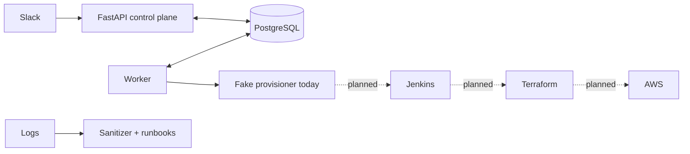

# EnvPilot

EnvPilot is a control plane for temporary, approved AWS sandbox environments. The repository currently has a **working local simulation** and integration scaffolds. Real AWS provisioning is not connected yet.

## Architecture



## Local setup

Python 3.11+ is required. Copy `.env.example` to `.env` and keep real tokens only in `.env` (Git ignores it). For a SQLite-only demo:

```powershell
python -m venv .venv
.venv\Scripts\Activate.ps1
pip install -e '.[dev]'
python -m envpilot.init_db
uvicorn envpilot.api:app --host 127.0.0.1 --port 8000
```

Start `python -m envpilot.worker` in another terminal. The API documentation is at `http://127.0.0.1:8000/docs`. `X-Actor-Id` is a **development-only identity stub**, not production authentication. Do not expose the API publicly. The worker runs a fake provider and never launches AWS resources.

For PostgreSQL, configure `POSTGRES_PASSWORD` in `.env` and run `docker compose up --build`. Database tables are initialized with `create_all`; versioned migrations remain to be implemented.

## Slack local demo

In your Slack app, enable Socket Mode, add bot scopes `commands` and `chat:write`, create `/envpilot`, and generate an app-level token with `connections:write`. Set `SLACK_BOT_TOKEN` and `SLACK_APP_TOKEN` in `.env`. Set `ENVPILOT_APPROVER_IDS` to a comma-separated list of Slack user IDs. The requester and approver must be different Slack users. Start the API and worker, then run `python -m envpilot.slack_app`. Commands: `/envpilot request <hours>`, `/envpilot list`, `/envpilot status <uuid>`, and `/envpilot destroy <uuid>`. Approval buttons are sent by DM to configured approvers.

The Slack adapter maps Slack user IDs to the local API's development header. This is safe only while the API is bound to localhost and inaccessible to untrusted callers. Before deployment, the API needs verifiable service-to-service authentication.

## Diagnostics

`envpilot.diagnostics.diagnose(log)` sanitizes common token patterns, classifies three known errors, cites a log line and runbook, and abstains when evidence is insufficient. It does not yet call Groq or ingest Jenkins logs. `GROQ_API_KEY` is reserved for that future integration; keep it private.

## Infrastructure scaffold

`infra/templates/ec2_sandbox` defines a fixed Sydney `t3.micro` with no inbound rule, no public IP, IMDSv2, encrypted 8 GiB root volume, and SSM role. `jenkins/Jenkinsfile` defines plan/apply/destroy stages. They are **not connected to the control plane and have not been validated with Terraform or AWS**. Do not give Jenkins AWS credentials or run apply/destroy until authorization and reconciliation are implemented.

## Tests and known gaps

Run `python -m pytest -q` (currently five tests). The current worker has no reliable lease recovery or uncertain-outcome reconciliation. It must not be used for real infrastructure. Missing work includes Alembic migrations, authenticated APIs, Jenkins launch/status integration, isolated state bucket bootstrapping, verified cleanup, Slack live testing, Groq integration, fault-injection evaluation, and real AWS validation. Results from the fake provider do not imply production reliability.
